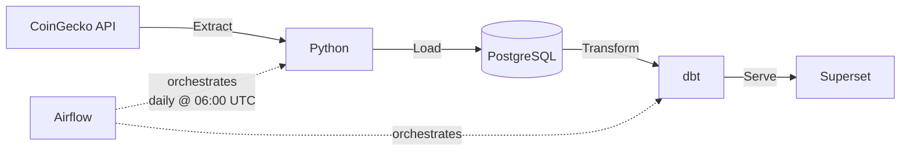
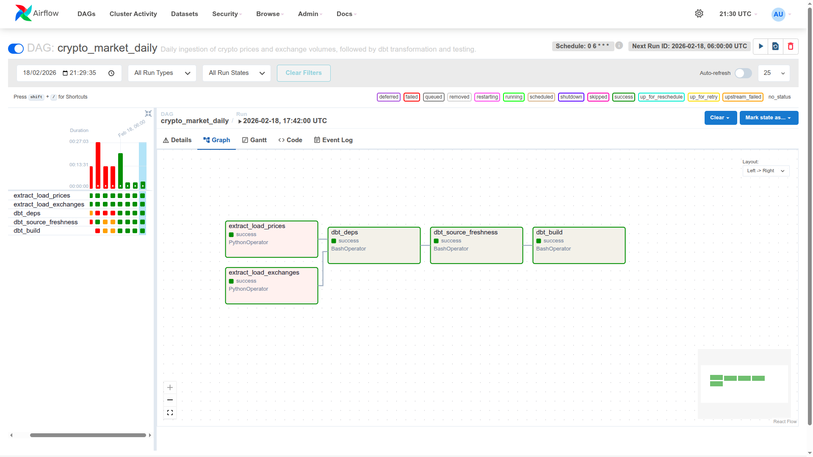
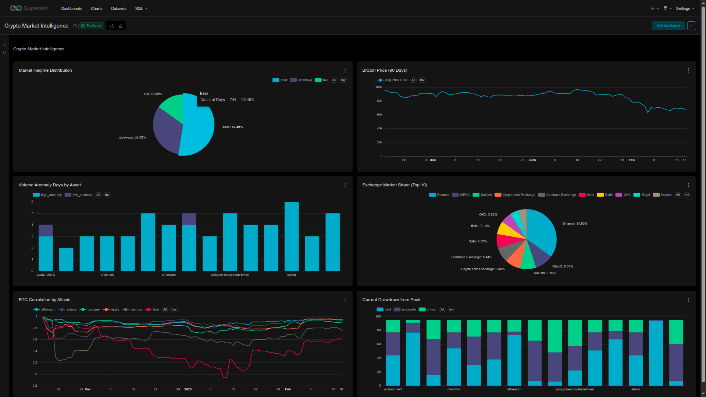
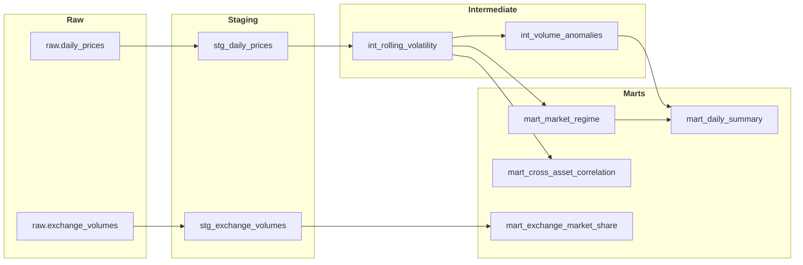
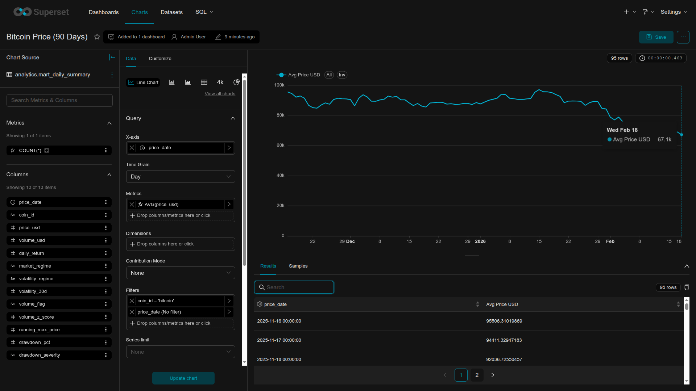
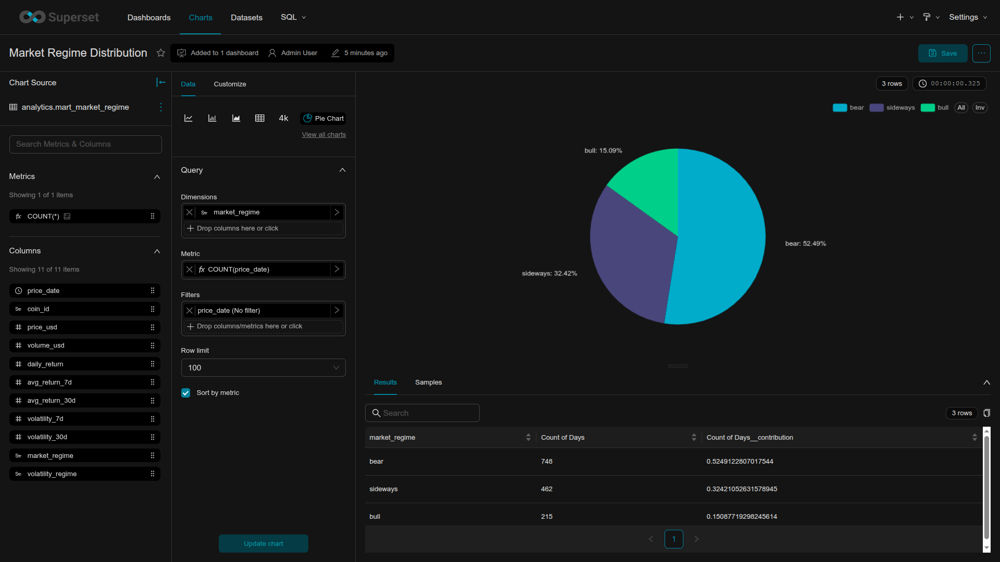
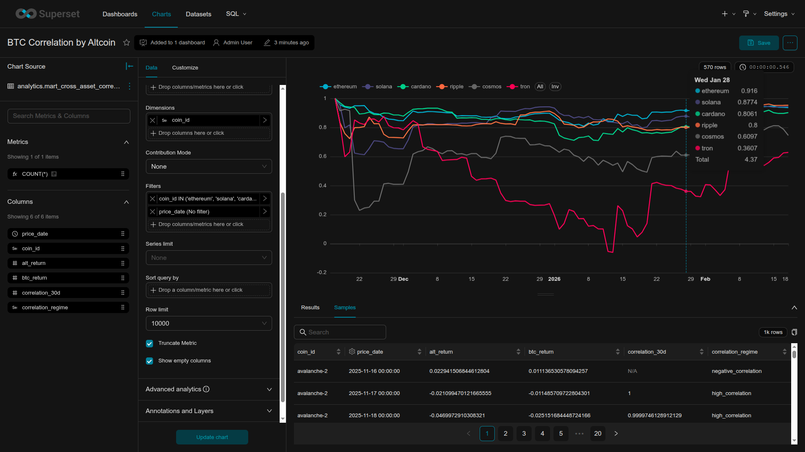
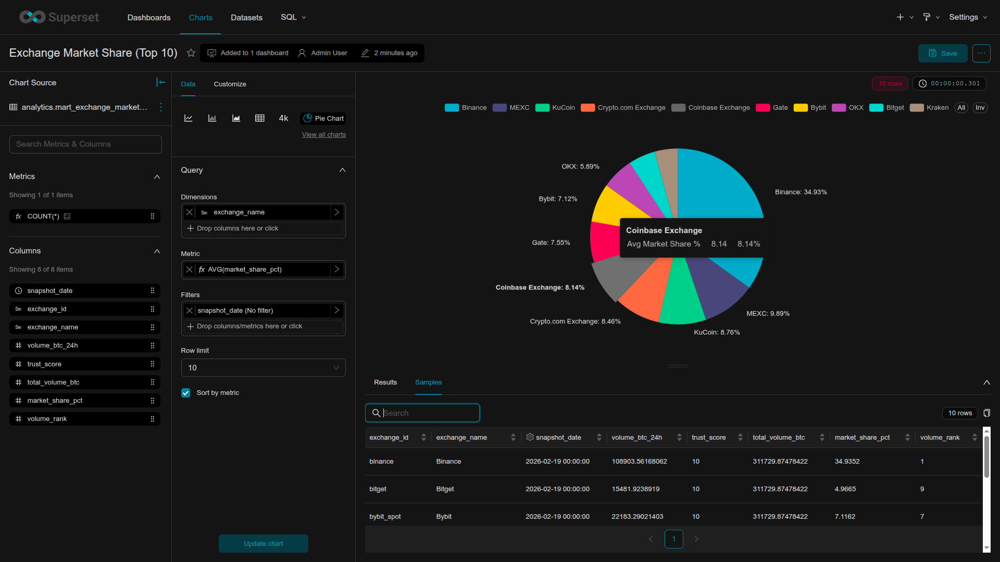
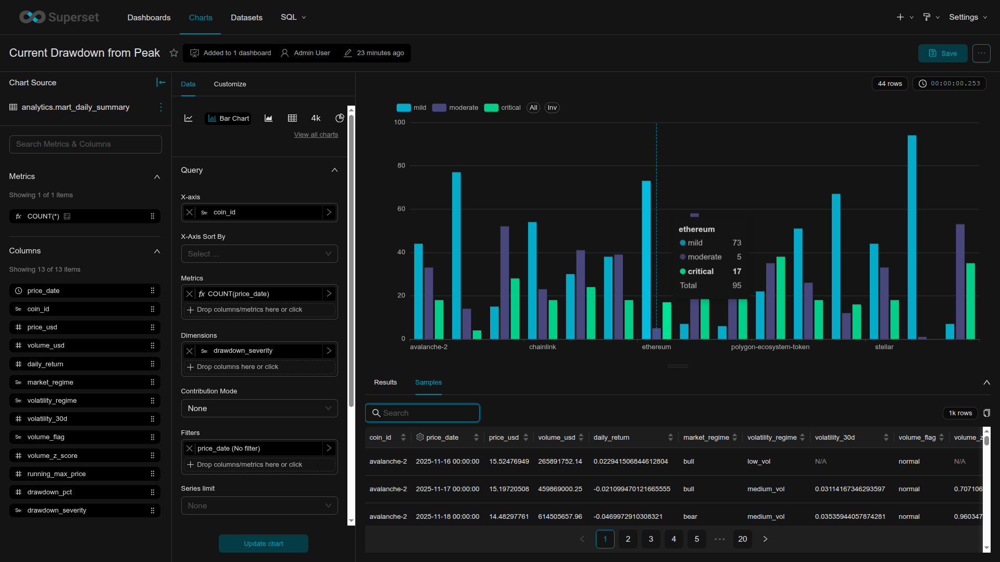
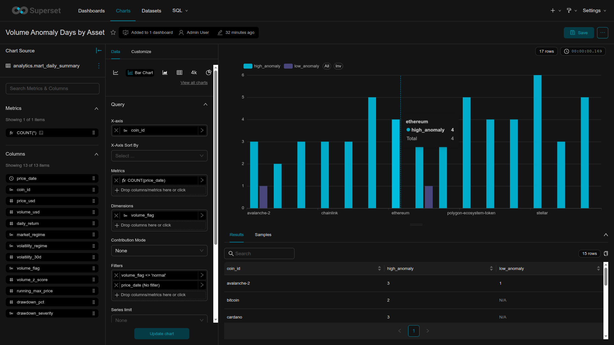

# Crypto Market Intelligence Pipeline

End-to-end data pipeline that ingests daily crypto market data from CoinGecko,
transforms it through a dbt analytics layer (volatility regimes, volume anomaly
detection, exchange market share), and orchestrates everything with Apache Airflow.

## Architecture



> All services containerized via Docker Compose.

## Key Design Decisions

### 1. Data Source: CoinGecko Free API

**Alternatives considered:**

- **CoinMarketCap API** - requires an API key even for the free tier, adds credential management overhead
- **Binance/Coinbase APIs** - exchange-specific, only covers their own trading pairs, not market-wide
- **CryptoCompare** - good but rate limits are stricter on the free plan
- **Yahoo Finance** - limited crypto coverage, primarily stocks

**Why CoinGecko:** Free, no auth needed, rich data (prices, volumes, exchanges, market caps) across the entire crypto market. Simplest to get started with for a portfolio project.

### 2. Extraction: Python + `requests`

**Alternatives considered:**

- **Apache Spark** - distributed processing framework, massive overkill for ~15 coins × 90 days (~1,350 rows)
- **Apache Kafka** - streaming platform for real-time ingestion, unnecessary when data is daily-granularity
- **Singer/Airbyte** - pre-built EL connectors, but CoinGecko's API is simple enough that a custom script is cleaner and more demonstrable
- **pandas + `read_json`** - could work, but adds a heavy dependency for what's just an HTTP call + insert

**Why Python + requests:** The API returns clean JSON. The total data volume is tiny. Writing a simple script with retry logic shows more engineering skill than plugging in a connector.

### 3. Warehouse: PostgreSQL

**Alternatives considered:**

- **Snowflake** - cloud data warehouse, excellent at scale but costs money and adds complexity for a local project
- **BigQuery** - same issue, requires a GCP account and billing
- **DuckDB** - great for local analytics but no server mode, so Airflow/dbt/Superset can't all connect to it as a shared warehouse
- **SQLite** - no concurrent connections, no proper upsert support, poor dbt support

**Why PostgreSQL:** Free, runs in Docker, supports `INSERT ... ON CONFLICT` for idempotent loads, works natively with dbt and Superset, and is a real production-grade database. Right-sized for ~15 assets at daily granularity.

### 4. Transformation: dbt

**Alternatives considered:**

- **Raw SQL scripts** - no testing, no lineage, no documentation, hard to maintain
- **Python (pandas/polars)** - transformations become opaque code instead of readable SQL; harder for analytics teams to review
- **Stored procedures** - vendor-locked, no version control, no built-in testing
- **Spark SQL** - again, overkill for this data volume

**Why dbt:** Industry standard for analytics engineering. SQL-based transforms are readable, testable, and version-controlled. Built-in features like `ref()` for lineage, schema tests, and documentation generation. This is what most data teams actually use.

### 5. Orchestration: Apache Airflow

**Alternatives considered:**

- **Prefect** - simpler Python-native orchestrator, but less industry adoption and fewer learning resources
- **Dagster** - asset-based orchestration, great but newer and less established
- **cron** - no retries, no dependency management, no UI, no logging
- **Luigi** - older, less community support, no built-in UI comparable to Airflow

**Why Airflow:** De facto industry standard. DAG-based scheduling with retries, dependency management, and a monitoring UI. Most data engineering job postings list it. Running it shows you can work with production orchestration tools.

### 6. Containerization: Docker Compose

**Alternatives considered:**

- **Kubernetes (K8s)** - production-grade container orchestration, but massive overhead for a local project
- **Running services natively** - "works on my machine" problem, painful setup for reviewers
- **Terraform + cloud** - infrastructure-as-code for cloud deployment, but adds cost and complexity

**Why Docker Compose:** One `docker compose up -d` and everything runs. Reproducible environment that anyone can clone and start. Right tool for local multi-service projects.

---

_The common theme: every alternative was either overkill for the data volume, added unnecessary cost/complexity, or was less industry-standard. The stack is deliberately right-sized - production-grade tools at local scale._

## Quick Start

### Prerequisites

- Docker and Docker Compose installed
- Git

### Setup

```bash
# Clone the repository
git clone https://github.com/hrootscraft/crypto-market-analysis.git
cd crypto-market-analysis

# Copy environment file
cp .env.example .env

# Start all services
docker compose up -d

# Wait ~60 seconds for initialization, then check UIs
# Airflow: http://localhost:8080 (admin / admin)
# Superset: http://localhost:8088 (admin / admin)
```

### Trigger the Pipeline

1. Open Airflow at `http://localhost:8080`
2. Find the `crypto_market_daily` DAG
3. Toggle it ON (if paused)
4. Click the "Play" button → "Trigger DAG"
5. Watch the tasks execute: `extract_load_prices` and `extract_load_exchanges` run in parallel, then `dbt_run`, then `dbt_test`



### Explore in Superset

Once the pipeline has run, Superset is pre-configured with the warehouse connection:

1. Open Superset at `http://localhost:8088` (admin / admin)
2. Go to **SQL Lab** → **SQL Editor** to query the mart tables directly
3. Create charts: **+ Chart** → select "Crypto Warehouse" database → pick a mart table
4. Build dashboards by combining charts into a single view



Key tables available in `analytics` schema:

- `mart_market_regime` — bull/bear/sideways classification per coin per day
- `mart_daily_summary` — dashboard-ready table with price, volume, regime, anomalies, drawdown
- `mart_cross_asset_correlation` — rolling 30-day BTC-altcoin correlation
- `mart_exchange_market_share` — exchange competitive positioning

### Verify Data

```bash
# Connect to the warehouse
docker exec -it crypto_warehouse psql -U crypto_user -d crypto

# Check raw data
SELECT coin_id, COUNT(*), MIN(price_date), MAX(price_date)
FROM raw.daily_prices GROUP BY 1 ORDER BY 1;

# Check mart output (use analytics_dev schema if running dbt locally with --target dev)
SELECT * FROM analytics.mart_market_regime
WHERE coin_id = 'bitcoin' ORDER BY price_date DESC LIMIT 10;

# Check exchange market share
SELECT * FROM analytics.mart_exchange_market_share
ORDER BY snapshot_date DESC, volume_rank LIMIT 10;
```

### Run Tests

```bash
# Python unit tests
pip install pytest requests psycopg2-binary
pytest tests/ -v

# dbt tests (runs inside the pipeline, or manually)
docker exec -it airflow_scheduler bash -c \
  "cd /opt/airflow/dbt_project && dbt test --profiles-dir . --target prod"
```

### Tear Down

```bash
docker compose down -v  # -v removes volumes (data)
```

## dbt Model Lineage



### Model Descriptions

| Layer        | Model                              | Grain           | Description                                                                |
| ------------ | ---------------------------------- | --------------- | -------------------------------------------------------------------------- |
| Staging      | `stg_daily_prices`                 | coin × day      | Cleaned, deduplicated daily price and volume data                          |
| Staging      | `stg_exchange_volumes`             | exchange × day  | Daily 24h volume snapshots for top 10 exchanges                            |
| Intermediate | `int_rolling_volatility`           | coin × day      | 7d and 30d rolling returns, volatility (σ), and volume statistics          |
| Intermediate | `int_volume_anomalies`             | coin × day      | Flags days where volume deviates >2σ from 30-day rolling mean              |
| **Mart**     | **`mart_market_regime`**           | coin × day      | Classifies each day as **bull/bear/sideways** + high/medium/low volatility |
| **Mart**     | **`mart_exchange_market_share`**   | exchange × day  | Each exchange's % share of total 24h BTC volume + daily rank               |
| **Mart**     | **`mart_cross_asset_correlation`** | coin-pair × day | Rolling 30-day Pearson correlation between BTC and each altcoin            |
| **Mart**     | **`mart_daily_summary`**           | coin × day      | Dashboard-ready table joining regime, anomalies, and drawdown from peak    |

### Why These Metrics Matter

| Metric                      | What It Answers                                                                                                                                                                                                   | Who Cares                                                        |
| --------------------------- | ----------------------------------------------------------------------------------------------------------------------------------------------------------------------------------------------------------------- | ---------------------------------------------------------------- |
| **Market regime**           | Was the market bullish or bearish when our metric moved? A 10% volume drop during a bear market is expected — not a product problem. Without this control, you'll misattribute market effects to product changes. | Data Scientists running experiments, PMs interpreting dashboards |
| **Volume anomalies**        | Did a whale trade, exchange outage, or black swan event happen on this day? These days confound A/B test results and need to be flagged for exclusion or adjustment.                                              | Experimentation teams, risk analysts                             |
| **Exchange market share**   | Is Coinbase gaining or losing volume share vs Binance, Kraken, OKX? Market share trends inform pricing strategy and take-rate optimization.                                                                       | Product strategy, business intelligence                          |
| **Cross-asset correlation** | When BTC-altcoin correlations → 1.0, the whole market moves together and diversification benefit disappears. Correlation breakdowns signal regime change.                                                         | Institutional clients (Coinbase Prime), portfolio risk models    |
| **Drawdown from peak**      | How far has each asset fallen from its 90-day rolling peak? Measures recent downside risk (not all-time high, but the local maximum within the analysis window).                                                  | Institutional sales, risk management                             |

<details>
<summary><b>Dashboard Charts</b> (click to expand)</summary>

**Bitcoin Price (90 Days)** - baseline price context for all downstream metrics



**Market Regime Distribution** - bull/bear/sideways classification per asset



**BTC-Altcoin Correlation** - rolling 30-day Pearson correlation tracks diversification benefit



**Exchange Market Share** - competitive positioning across top exchanges



**Drawdown from Peak** - severity distribution shows how deep each asset has fallen



**Volume Anomalies (90 Days)** - days flagged for abnormal trading volume per asset



</details>

## Analysis Notebook

Once the pipeline runs, explore the data through the **[Analytical Deep-Dive Notebook](analysis/crypto_market_analysis.ipynb)** — a Plotly-powered analysis framed around Coinbase-relevant business questions:

| Analysis                   | Business Question                                              |
| -------------------------- | -------------------------------------------------------------- |
| Market Regime Distribution | What % of days was each asset in bull/bear/sideways?           |
| Volume Anomaly Detection   | Which days should be excluded from A/B tests?                  |
| Cross-Asset Correlation    | Is there any diversification benefit across altcoins?          |
| Exchange Market Share      | How is competitive positioning evolving?                       |
| Drawdown from Peak         | Which assets carry the most risk exposure?                     |
| Regime-Adjusted Volume     | How much of a volume drop is market-driven vs. product-driven? |

```bash
# Run the notebook
pip install -r requirements.txt
jupyter notebook analysis/crypto_market_analysis.ipynb
```

<details>
<summary><b>Data Reliability</b> (click to expand)</summary>

### dbt Tests (automated checks)

**Schema tests** run on every model via YAML config (`_staging.yml`, `_intermediate.yml`, `_marts.yml`):

| Test Type                                  | What It Catches                          | Example                                                                                                                 |
| ------------------------------------------ | ---------------------------------------- | ----------------------------------------------------------------------------------------------------------------------- |
| `not_null`                                 | Missing values in key columns            | `coin_id`, `price_date`, `daily_return`, `market_regime`                                                                |
| `unique` / `unique_combination_of_columns` | Duplicate rows that inflate aggregations | Every model tested on its grain (e.g. coin × day)                                                                       |
| `accepted_range`                           | Values outside valid bounds              | `price_usd > 0`, `volatility_7d >= 0`, `volatility_30d >= 0`, `drawdown_pct` in [-100, 0], `correlation_30d` in [-1, 1] |
| `accepted_values`                          | Invalid categorical labels               | `market_regime` in (bull, bear, sideways), `volume_flag` in (high_anomaly, low_anomaly, normal)                         |
| `relationships`                            | Broken foreign key references            | Staging models reference raw source tables                                                                              |

**Singular tests** catch business-logic failures that schema tests can't express:

| Test File                                      | What It Guards Against                                                                                                                                                 |
| ---------------------------------------------- | ---------------------------------------------------------------------------------------------------------------------------------------------------------------------- |
| `assert_daily_prices_within_90_day_window.sql` | CoinGecko's `days=90` parameter sometimes returns >90 days. If the staging trim breaks, downstream "30-day volatility" silently covers a wider window than documented. |
| `assert_no_date_gaps.sql`                      | Missing dates corrupt rolling window functions — a "7-day" average computed across a gap covers fewer than 7 actual days with no error raised.                         |
| `assert_no_negative_volumes.sql`               | Negative volumes are physically impossible and indicate data corruption or API parsing errors.                                                                         |
| `assert_market_share_sums_to_100.sql`          | Exchange market share percentages must sum to ~100% per day. Drift means an exchange was dropped or double-counted.                                                    |
| `assert_mart_row_count_not_exceeds_raw.sql`    | Mart tables should never have more rows than raw — a sign of accidental fan-out from a bad join.                                                                       |

### Staging-Level Data Trimming

CoinGecko's free API returns slightly more than 90 calendar days even when `days=90` is requested. The staging model [`stg_daily_prices.sql`](dbt_project/models/staging/stg_daily_prices.sql) enforces the exact 90-day window:

```sql
where price_date > (select max(price_date) - interval '90 days' from raw.daily_prices)
```

This ensures every downstream metric (7-day rolling average, 30-day volatility, etc.) covers exactly the window the documentation says it does.

### Loader-Level Deduplication

The Python loader ([`loader.py`](extract/loader.py)) uses `INSERT ... ON CONFLICT DO UPDATE` (upsert) so re-running extraction for the same date overwrites rather than duplicates. The staging layer adds a second deduplication pass using `ROW_NUMBER()` partitioned by `(coin_id, price_date)` to guarantee one row per coin per day regardless of source quirks.

### Airflow DAG Ordering

The DAG runs `dbt test` as a dedicated task _after_ `dbt run`. If any of the tests fail, the Airflow task fails and alerts fire; data doesn't silently flow into Superset with broken invariants.

</details>

## Project Structure

```
crypto-market-pipeline/
├── README.md                           # This file
├── docker-compose.yml                  # All services: Postgres, Airflow
├── init_db.sql                         # DDL for raw schema tables
├── .env.example                        # Template for environment variables
├── .gitignore
│
├── config/
│   └── __init__.py                     # Centralized config (env vars)
│
├── extract/
│   ├── __init__.py
│   ├── coingecko.py                    # API extraction with retry logic
│   └── loader.py                       # Postgres upsert functions
│
├── dags/
│   └── crypto_market_daily.py          # Airflow DAG definition
│
├── dbt_project/
│   ├── dbt_project.yml
│   ├── profiles.yml
│   ├── models/
│   │   ├── staging/                    # Clean + deduplicate raw data
│   │   │   ├── _staging.yml
│   │   │   ├── stg_daily_prices.sql
│   │   │   └── stg_exchange_volumes.sql
│   │   ├── intermediate/               # Compute derived metrics
│   │   │   ├── _intermediate.yml
│   │   │   ├── int_rolling_volatility.sql
│   │   │   └── int_volume_anomalies.sql
│   │   └── marts/                      # Business-ready tables
│   │       ├── _marts.yml
│   │       ├── mart_market_regime.sql
│   │       ├── mart_cross_asset_correlation.sql
│   │       ├── mart_exchange_market_share.sql
│   │       └── mart_daily_summary.sql
│   └── tests/
│       ├── assert_daily_prices_within_90_day_window.sql
│       ├── assert_market_share_sums_to_100.sql
│       ├── assert_mart_row_count_not_exceeds_raw.sql
│       ├── assert_no_date_gaps.sql
│       └── assert_no_negative_volumes.sql
│
├── superset/
│   ├── superset_config.py              # Superset configuration
│   ├── superset-init.sh                # Bootstrap: DB migrate + admin user + warehouse connection
│   └── bootstrap-dashboard.py          # Auto-creates charts, dashboard, and saved queries
│
├── analysis/
│   └── crypto_market_analysis.ipynb    # Plotly analytical deep-dive
│
├── tests/
│   └── test_extraction.py              # Python unit tests (pytest)
│
└── dashboards/
    └── screenshots/                    # Dashboard screenshots for README
```

## Production Considerations

This is a portfolio project running locally. For a production deployment, I would:

- **Compute**: Deploy Airflow on AWS ECS/EKS with CeleryExecutor for parallel task execution
- **Warehouse**: Migrate from Postgres to Snowflake or Databricks for scalability
- **Credentials**: Use Airflow Connections and AWS Secrets Manager instead of environment variables
- **Monitoring**: Add Airflow alerting (Slack/PagerDuty on task failure), dbt source freshness checks
- **CI/CD**: GitHub Actions to run `dbt test` and `pytest` on every PR
- **Data quality**: Add Great Expectations or dbt elementary for more comprehensive data validation
- **Backfill**: Parameterize the DAG with execution_date for historical backfills

## Tech Stack

| Tool            | Version | Purpose                           |
| --------------- | ------- | --------------------------------- |
| Python          | 3.11    | Extraction, orchestration logic   |
| PostgreSQL      | 16      | Data warehouse                    |
| Apache Airflow  | 2.10    | Pipeline orchestration            |
| dbt-postgres    | latest  | SQL transformations and testing   |
| Apache Superset | latest  | Self-serve dashboards and SQL Lab |
| Docker Compose  | 3.8     | Containerization                  |
